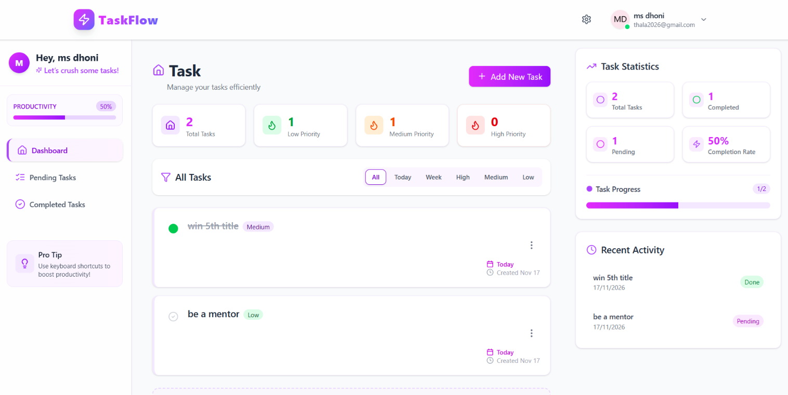

# TaskA2Z

A full-stack task management app built with the MERN stack. Users can sign up, log in, and manage their tasks from a clean dashboard.

**Live demo:** [task-a2-z.vercel.app](https://task-a2-z.vercel.app)

> **Note:** The backend runs on a free Render instance that sleeps when idle. The first request after a period of inactivity can take 30-60 seconds to respond. After that it works normally.



## Features

- User sign up and login with JWT authentication
- Passwords hashed with bcrypt
- Create, view, and manage tasks
- Pending tasks view
- Profile page
- Responsive React frontend

## Tech Stack

**Frontend:** React, Vite, React Router, Axios

**Backend:** Node.js, Express, Mongoose, JSON Web Tokens, bcrypt, validator

**Database:** MongoDB Atlas

**Deployment:** Vercel (frontend), Render (backend)

## Project Structure

```
taskA2Z/
├── backend/     # Express API
│   ├── config/  # Database connection
│   ├── routes/  # User and task routes
│   └── server.js
└── frontend/    # React app
```

## API Routes

| Route         | Purpose                        |
| ------------- | ------------------------------ |
| `/api/user`   | Sign up, login, user profile   |
| `/api/tasks`  | Create and manage tasks        |

## Run Locally

**Prerequisites:** Node.js and a MongoDB Atlas connection string.

1. Clone the repo:
   ```bash
   git clone https://github.com/jessengeek/taskA2Z.git
   cd taskA2Z
   ```

2. Set up the backend:
   ```bash
   cd backend
   npm install
   ```
   Create a `.env` file in the `backend` folder:
   ```
   JWT_SECRET=your_secret_here
   MONGOO_URI=your_mongodb_connection_string
   PORT=4000
   ```
   Start the server:
   ```bash
   npm run dev
   ```

3. Set up the frontend (in a new terminal):
   ```bash
   cd frontend
   npm install
   npm run dev
   ```
   The frontend files currently point to the deployed backend. To use your local backend, replace `https://taska2z.onrender.com` with `http://localhost:4000` in the frontend files that make API calls.

4. Open the local URL shown in the terminal (usually `http://localhost:5173`).

## Author

**Jesse** - MERN stack developer

- GitHub: [jessengeek](https://github.com/jessengeek)
- LinkedIn: [jessen-t](https://www.linkedin.com/in/jessen-t)
